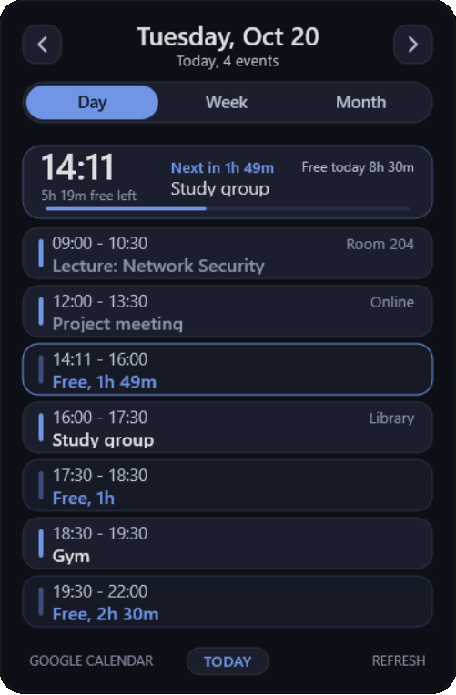
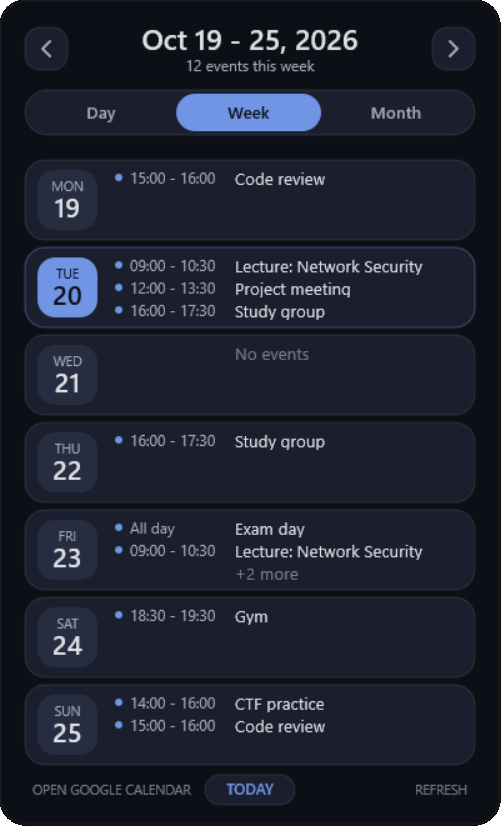
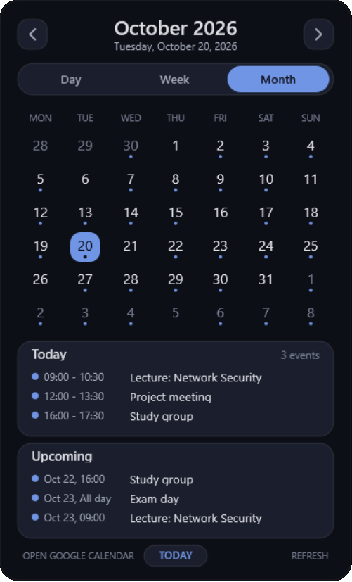
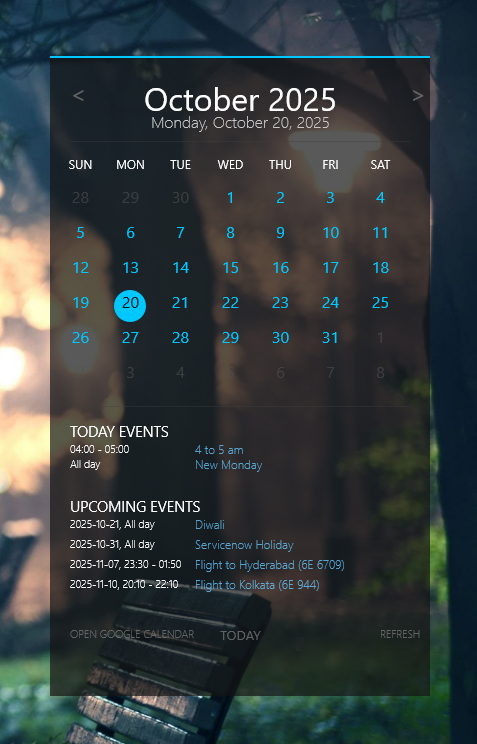

<div align="center">

# CyberCalendar

**A dark, rounded Google Calendar skin for [Rainmeter](https://www.rainmeter.net/) with Day, Week and Month views, a live "now" card and a free-time timeline.**


<br>

&nbsp;
&nbsp;


<sub>Day · Week · Month (screenshots use demo data)</sub>

</div>

---

## Before and after

This is a fork of [Gourav2000/CyberCalender](https://github.com/Gourav2000/CyberCalender). The original shows one month grid; this fork turns it into a daily planner.

| Original | This fork |
| :---: | :---: |
|  |  |

## Highlights

- **Three views:** Day, Week and Month tabs. Day opens by default.
- **Day view:**
  - a "now" card with the current time, the time until the next event (or what is left of the current one), the free time left today, a progress bar of the day and the total free time of the day;
  - a timeline of events with **free windows** between them, so you can see at a glance when you are actually free;
  - past events are dimmed, the current one is highlighted, past free time is hidden;
  - free windows longer than 8 hours are hidden on purpose (that is usually sleep).
- **Week view:** seven day cards with up to three events each and "+N more". Click a card to open that day.
- **Month view:** colour-coded event dots per calendar, the selected day's events and the next upcoming events. Double-click a day to open it in Day view.
- **Adaptive size:** the panel shrinks when there are few events.
- **Recurring events** are expanded (daily, weekly, monthly, yearly), including excluded and moved occurrences.
- **Two Google calendars** at once, each with its own accent colour.
- **Correct time zones:** UTC and `TZID` times are converted to your time zone, and the clock follows the same zone.
- **Always on top friendly:** the empty area around the panel is click-through, so it works well on a second monitor.
- **One palette to rule them all:** every colour is a variable, so re-theming takes a minute.

## Installation

1. Install [Rainmeter](https://www.rainmeter.net/).
2. Put the project folder into your Rainmeter skins directory (usually `Documents\Rainmeter\Skins\`).
3. Get a private iCal link for each calendar: Google Calendar > Settings > pick a calendar > *Integrate calendar* > **Secret address in iCal format**.
4. Copy `@Resources\Variables.inc.example` to `@Resources\Variables.inc` and paste your link(s):

   ```ini
   [Variables]
   GoogleCalendarICS1=https://calendar.google.com/calendar/ical/.../basic.ics
   GoogleCalendarICS2=
   ```

   `Variables.inc` is listed in `.gitignore`, so your private links are never committed.
5. Open Rainmeter, refresh the skin list and load **CyberCalender > Calendar.ini**.

To keep the calendar above other windows, right-click it and choose *Position > Always on top*.

## Usage

| Action | Result |
| --- | --- |
| **Day / Week / Month** tabs | Switch the view |
| **‹ ›** arrows | Previous / next day, week or month (depending on the view) |
| Click the title | Month picker (jump to any month) |
| Click a day in Month | Select it and show its events |
| Double-click a day in Month | Open it in Day view |
| Click a day card in Week | Open it in Day view |
| **TODAY** | Back to today |
| **REFRESH** | Reload the skin and the calendar data |

## Configuration

Settings live in the `[Variables]` section of `Calendar.ini` (and the optional ones in `@Resources\Variables.inc`).

| Variable | Default | Meaning |
| --- | --- | --- |
| `WeekStart` | `1` | `0` = week starts on Sunday, `1` = on Monday |
| `DayStart` / `DayEnd` | `8` / `22` | Hours of the day used to look for free time |
| `MinGap` | `30` | Shortest free window to show (minutes) |
| `MaxFreeGap` | `480` | Longest free window to show (minutes); longer ones are treated as sleep |
| `DailyAsRoutine` | `1` | Events that repeat every day (wake up, sleep...) are shown only in Day view; set `0` to show them everywhere |
| `UtcOffsetHours` | *(empty)* | Optional, goes in `Variables.inc`. Forces a fixed UTC offset (for example `5` for Tyumen) instead of the Windows time zone |
| `Color*` | dark blue palette | All colours; `ColorAccent` is the main accent |
| `FontFace`, `FontFaceTitle` | `Segoe UI`, `Segoe UI Semibold` | Fonts |

### Time zones

Event times with `Z` (UTC) or a known `TZID` (Moscow, Yekaterinburg, Kolkata and a few more, see `ZONES` in `Calendar.lua`) are converted to the display time zone. The display time zone is your Windows time zone unless `UtcOffsetHours` is set. If every event looks shifted by a few hours, compare the Windows time zone with the one in Google Calendar and fix one of them.

## Project structure

```text
CyberCalender/
├── Calendar.ini            # Meters and styles (the skin itself)
├── @Resources/
│   ├── Calendar.lua        # Views, ICS parsing, free-time logic, layout
│   ├── Variables.inc       # Your private ICS links (gitignored, create from the .example)
│   └── Variables.inc.example
├── docs/                   # Screenshots used in this README
├── CHANGELOG.md            # Everything that changed in this fork
└── Screenshot.png          # Screenshot of the original skin
```

## Known limitations

- Recurring events: `DAILY`, `WEEKLY` (with `BYDAY`), `MONTHLY` and `YEARLY` (same day) rules with `INTERVAL`, `COUNT`, `UNTIL`, excluded dates and moved instances are supported. "Every first Monday"-style rules (`BYDAY` with a week number, `BYMONTHDAY`) are not.
- The Rainmeter window does not shrink together with the panel. The empty area is transparent and click-through, so it is only visible in the window frame.
- Only a short list of time zones with a fixed offset is understood for `TZID`; an unknown `TZID` is shown as written.

## Troubleshooting

- **No events:** check the links in `Variables.inc`, make sure the file starts with `[Variables]`, then press **REFRESH**.
- **Times are shifted:** see [Time zones](#time-zones).
- **Raw text like `[&MeasureCalendarScript:...]` on the panel:** the Lua script failed to load; check the Rainmeter log for the exact error.

## Credits

Original skin: [Gourav2000/CyberCalender](https://github.com/Gourav2000/CyberCalender). This fork adds the Day and Week views, the free-time logic, the new design, time zone handling and the code cleanup. See [CHANGELOG.md](CHANGELOG.md) for details. Licensing follows the original repository.
